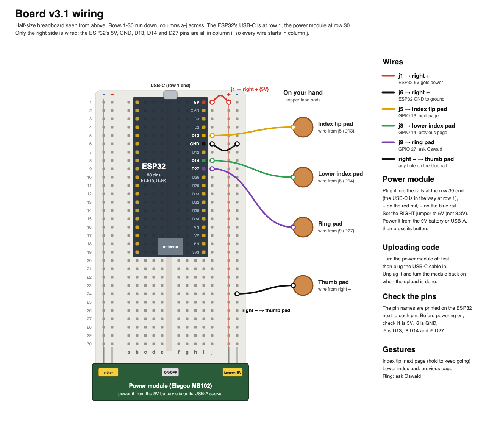

# Board

A study reader you control from your hand (SBUHacks 2026, "Steel and Steam").
Put your lecture slides, PDFs, Word and Pages files or web pages in the reader. Touch a fingertip
to your thumb to turn the page, and touch your ring finger to ask **Oswald**, a calm British engineer who reads
along with you. He answers out loud, shows you the page, and writes your notes, study guides,
quizzes and flashcards, which you keep in folders next to your lectures.

```
Board (ESP32) ── Bluetooth keyboard ──> the laptop
   index tip: next page      lower index: previous page      ring: ask Oswald
The laptop runs the reader at http://localhost:8000, and Oswald (Gemini)
```

## What you need

**Parts**

| Part | Price |
|---|---|
| ESP32-WROOM dev board, 38 pins, USB-C (we used the Inland one from Micro Center) | $__.__ |
| Half-size breadboard and jumper wires | $__.__ |
| Breadboard power module (the Elegoo MB102 from the starter kit) and a 9 V battery with its clip | $__.__ |
| Copper foil tape for the four finger pads, and thin wire | $__.__ |
| USB-C data cable, to put the code on the board (a charge-only cable won't work) | $__.__ |
| A strap to hold the breadboard on your hand | $__.__ |

**On the laptop** (all free)

1. [Arduino IDE 2](https://www.arduino.cc/en/software), to put the code on the board.
2. **Python 3**. Macs usually have it: type `python3 --version` in Terminal. If not, get it
   from [python.org](https://www.python.org/downloads/).
3. **Google Chrome**, for the reader.
4. A **Gemini API key**: free at [aistudio.google.com/apikey](https://aistudio.google.com/apikey).

## Set it up

### 1. Wire the board



Half-size breadboard, rows 1–30 down, columns **a–j** across. The ESP32 sits in **b1–b19** and
**i1–i19** with its USB-C at the row 1 end. Every wire starts in column **j**, next to the
ESP32's pins.

| Wire | From | To |
|---|---|---|
| Power | j1 (ESP32 **5V**) | right **+** rail |
| Ground | j6 (ESP32 **GND**) | right **−** rail |
| Index tip | j5 (ESP32 **D13**) | index tip pad |
| Lower index | j8 (ESP32 **D14**) | lower index pad |
| Ring finger | j9 (ESP32 **D27**) | ring pad |
| Thumb | any hole on the right **−** rail | thumb pad |

- **Power module:** plug it onto the rails at the row 30 end (+ on the red rail, − on the blue
  one) and set the right jumper to **5V**. Clip in the 9 V battery and press its button. The
  ESP32 runs from it, no USB cable needed.
- **Check the pins** before you switch on: the names are printed next to the pins on the ESP32.
  i1 should be 5V, i6 GND, i5 D13, i8 D14 and i9 D27. If 5V is printed next to b1 instead, the
  ESP32 is the other way round: use the same rows in column **a** and the left rails.
- **Finger pads:** a strip of copper tape on the tip of your thumb, the tip of your index
  finger, lower down your index finger (where your thumb reaches when you slide it down), and
  the tip of your ring finger, each with its wire.

### 2. Put the code on the board

1. In Arduino IDE: **Tools → Board → Boards Manager**, search **esp32**, install **esp32 by
   Espressif Systems**. (Mac with an Apple chip: run
   `softwareupdate --install-rosetta --agree-to-license` in Terminal first.)
2. **Switch the power module off**, then plug the ESP32 into the laptop with the USB-C cable.
3. Open `firmware/board_core/board_core.ino`.
4. **Tools → Board → esp32 → ESP32 Dev Module**, and **Tools → Port** → the board.
5. Click **Upload**. If it sticks on "Connecting…", hold the board's BOOT button until it starts.
6. Unplug the cable and switch the power module back on.

### 3. Pair it with the laptop

**System Settings → Bluetooth → Board → Connect**. It pairs like a keyboard.
If Board isn't in the list, see "Board isn't in the Bluetooth list" below.

### 4. Start the reader

- **Mac, easiest:** double-click **`start.command`** in the board folder (the first time,
  right-click it and choose **Open**). It installs what it needs and opens the reader in Chrome.
- **Or in Terminal:**
  ```
  cd path/to/board/hub
  python3 -m pip install sounddevice pynput
  python3 board_hub.py
  ```

Paste your Gemini key when it asks (it's saved in `hub/.env`, on this laptop only).

The first time, the Mac asks to let **Terminal** do a few things. Allow them in **System
Settings → Privacy & Security**, then quit and reopen Terminal:

| Setting | What it's for |
|---|---|
| Microphone | Oswald hears you |
| Accessibility and Input Monitoring | asking Oswald works in every app, not just the reader |

## Using it

| Touch your thumb with | What happens |
|---|---|
| Index tip | Next page (hold to keep going) |
| Lower index pad | Previous page (hold to keep going back) |
| Ring finger | **Ask Oswald**. He answers, then stops listening. Touch again to stop him talking |

1. **Add your documents**: click **Add file** (or drag files onto the reader) or **Add link**
   for a web page. PDFs, slides (Keynote, PowerPoint), Word, Pages, text and web pages all
   become pages, so the index pads turn them. Long web pages are cut into pages too.
2. **Ask Oswald** anything about what you're reading: "what does this mean?", "give me an
   example", "where does it talk about entropy?". He answers out loud and shows the page.
   Highlight words first and he knows that's what you mean.
3. **Have him write for you**: the buttons make **Notes**, a **Study guide**, a **Summary**,
   a **Quiz** or **Flashcards** from the open document. Or just say it: "make a study guide
   from lecture 1 and 2". His notes link back to the pages they came from.
4. **Quizzes and flashcards** are pages too: the index tip goes to the next question or turns the
   card over. Answer by clicking, pressing A to D, or telling Oswald the letter.
5. **Change notes**: say "add the worked example to my notes", or click **Edit** and type.
6. **Research**: "look up who built the first steam turbine and add it to my notes".
7. **Folders**: **New folder**, then drag documents onto it, or tell Oswald "put lecture 1 and 2
   in a Thermodynamics folder". Notes and quizzes sit under the lecture they were made from.
   **Arrange** renames, moves or deletes a document.

**Oswald's voice:** pick one under **Engine room**. The most natural British voice is
**Jamie (Premium)**, free from Apple: System Settings → Accessibility → Read & Speak →
System voice → Manage Voices → English (UK). Download it, then reload the reader.

### Why it's cheap to run

Oswald never sends Gemini your whole library with a question. He sends the page on your
screen, what you highlighted, and the few passages from your other documents that match the
question, so a question is a few thousand characters. Whole documents only go when he writes
notes, a guide or a quiz, once. He answers without thinking it over first, which is faster too.
Settings like `PASSAGES` and `KEEP_LISTENING` are at the top of `hub/board_hub.py`.

## If something's wrong

| Problem | Fix |
|---|---|
| Board isn't in the Bluetooth list | If the Mac paired with it before, it hides it: in System Settings → Bluetooth, find **Board** under My Devices, click **ⓘ → Forget This Device**. Then press the ESP32's EN (reset) button and wait for Board to appear under Nearby Devices. Also check the power module is on and set to 5V |
| Fingers do nothing | Click into the reader. If Board was paired before, remove it in Bluetooth settings, press the board's reset button, pair again |
| Ring finger does nothing | Keep the reader in front, or allow Terminal under Accessibility and Input Monitoring (then reopen Terminal) |
| Oswald doesn't hear you | Allow Terminal under Microphone, then reopen Terminal. If the mic library isn't installed he listens through Chrome: allow the mic there |
| He stops listening before you ask | He waits about 8 seconds for you to start. Touch again, or raise `WAIT_FOR_QUESTION` in `hub/board_hub.py` |
| A Pages or Keynote file won't open | Let Terminal control Pages or Keynote when the Mac asks, or export it as a PDF |
| "Couldn't search the web" | Your free key can't use Google Search right now. Oswald answers from what he knows and says so |
| "Gemini is overloaded" | Google is busy. Wait a minute; the hub already tries other models |

## AI Acknowledgment

Claude Code (Opus 5.5) used in creating project.

## What's in here

```
start.command                        double-click to start (Mac)
board_wiring.png                     the wiring diagram
firmware/board_core/board_core.ino   the board's code
hub/board_hub.py                     Oswald, the library and the reader's server
hub/dashboard.html                   the reader
hub/oswald.txt                       Oswald's personality
hub/library/                         your documents and Oswald's notes (made when you add one)
hub/pdfjs/                           Mozilla's PDF.js, which shows PDFs (Apache 2.0)
tests/run_all.sh                     the tests (they need Chrome, nothing else)
```

Never put `hub/.env` (your key) on GitHub.
